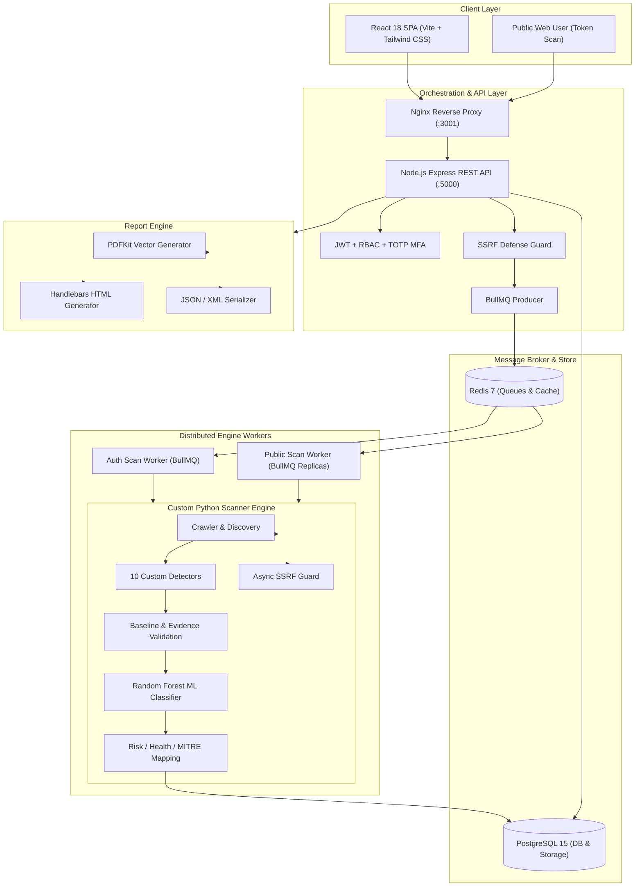

<div align="center">

# 🛡️ VulnScan Pro

### Enterprise-Grade Integrated Vulnerability Assessment & Security Reporting Platform

[](https://github.com/YUVARAJKK/VulnScan-Pro)
[](https://www.python.org/)
[](https://nodejs.org/)
[](https://react.dev/)
[](https://www.docker.com/)
[](https://www.postgresql.org/)
[](https://redis.io/)
[](LICENSE)

<p align="center">
  <b>A self-hosted, full-stack cybersecurity orchestration platform powered by an in-house Python vulnerability scanning engine, AI/ML false-positive verification, MITRE ATT&CK® matrix mapping, and consulting-grade executive reporting.</b>
</p>

[Key Features](#-key-features) •
[Architecture](#-system-architecture) •
[Scanner Engine](#-custom-python-scanning-engine) •
[ML Classification](#-aiml-false-positive-reduction) •
[Quick Start](#-quick-start) •
[Documentation](#-documentation)

---

</div>

## 📌 Architectural Statement & Novelty

> **Primary Contribution:** VulnScan Pro is built around a **100% project-owned, custom Python asynchronous scanning engine** (`scanner_engine/`). Established third-party wrappers (Nmap, Nikto, OWASP ZAP) are **not** bundled or emulated. Every phase—from same-origin link discovery, HTTP header and cookie analysis, active parameter injection, response differential analysis, to baseline comparison—is engineered directly into the platform codebase.

---

## 🚀 Key Features

### 🔍 Custom Python Vulnerability Scanning Engine
- **Non-Destructive Active & Passive Scanning**: Same-origin crawler with robots.txt, sitemap.xml, HTML form parsing, and heuristic technology fingerprinting.
- **10 In-House Specialized Detectors**:
  - `xss.py`: Reflected Cross-Site Scripting (context-aware reflection analysis: HTML body, attribute, and script context).
  - `sqli.py`: Error-based pattern matching (25+ RDBMS signatures) and differential anomaly detection.
  - `cors.py`: Origin reflection, null origin trust, wildcard permissions with credential exposure.
  - `path_traversal.py`: Relative directory traversal & sensitive system file detection (`/etc/passwd`, `win.ini`).
  - `open_redirect.py`: Unvalidated destination header and parameter hopping.
  - `directory_exposure.py`: Common administrative portals, `.git` leaks, backups, and exposed sensitive directories.
  - `information_disclosure.py`: Private IP leaks, server banners, stack traces, secret keys, and email extraction.
  - `security_headers.py`: Analysis of CSP, HSTS, X-Frame-Options, X-Content-Type-Options, Referrer-Policy, Permissions-Policy.
  - `cookie_security.py`: Missing `Secure`, `HttpOnly`, `SameSite` flags.
  - `http_methods.py`: Detection of dangerous HTTP methods (`PUT`, `DELETE`, `TRACE`).

### 🤖 Machine Learning False-Positive Reduction
- **34-Dimensional Feature Schema**: Extracts structural evidence metrics including payload reflection status, DOM context, baseline response body diffs, header diffs, status variations, and timing differentials.
- **Random Forest Classifier**: Pre-trained supervised classifier categorizing candidate findings into **Likely Genuine** vs. **Likely False Positive**.
- **Transparent Rule-Based Fallback**: When no pre-trained model artifact is present, the engine dynamically reverts to an explainable deterministic heuristic and flags every result for manual triage without fabricating confidence scores.

### 🛡️ Enterprise SSRF & Target Isolation
- **Dual-Layer SSRF Guard**: Enforced concurrently in both Node.js API and Python scanner layers.
- **Strict IP Filtering**: Completely blocks loopbacks (`127.0.0.0/8`), private ranges (`10.0.0.0/8`, `172.16.0.0/12`, `192.168.0.0/16`), Carrier-Grade NAT (`100.64.0.0/10`), IPv6 ULA/link-local, IPv4-mapped IPv6, and Cloud Metadata endpoints (`169.254.169.254`).
- **Dynamic Re-Validation**: Re-evaluates destination IPs on every HTTP 3xx redirect hop during scans to prevent DNS rebinding attacks.

### 📊 Canonical Severity, Risk & MITRE ATT&CK® Engine
- **Explainable Severity-Band Risk Model**: Calculates a 0–100 Risk Score and Security Health Score with letter grades (`A+` to `F`).
- **MITRE ATT&CK Matrix Mapping**: Automatically maps discoveries to standardized enterprise tactics (Initial Access, Execution, Persistence, Defense Evasion, Credential Access, Discovery).
- **Remediation Roadmap**: Step-by-step contextual developer remediation guidelines, RFC citations, and OWASP Top 10 references.

### 📑 Comprehensive Multi-Format Reporting
- **Consulting-Grade PDF Generator**: Cover page, executive summary with threat gauge, severity charts, detailed evidence logs, MITRE ATT&CK matrix, and remediation roadmap.
- **Interactive HTML Report**: Standalone web report complete with client-side severity filtering, full PoC details, and responsive layout.
- **Machine-Readable JSON / XML**: Clean, standardized schemas ready for SIEM, SOAR, or Jira/DevOps ingestion.

---

## 🏛️ System Architecture



---

## 📂 Project Structure

```text
├── scanner_engine/               # ★ CORE PYTHON SCANNER ENGINE (Independent Module)
│   ├── main.py                   # CLI entrypoint for distributed worker execution
│   ├── config.py                 # Engine configuration, timeouts, concurrency bounds
│   ├── core/                     # Asynchronous HTTP client, SSRF guard, URL utilities
│   ├── discovery/                # Crawler, robots.txt/sitemap discovery, tech detection
│   ├── detectors/                # 10 specialized detection modules (XSS, SQLi, CORS, etc.)
│   ├── validation/               # Baseline diffing, evidence verification, deduplication
│   ├── analysis/                 # Severity weights, health score, CVSS v3.1 model
│   ├── mitre/                    # Enterprise MITRE ATT&CK tactic/technique mapper
│   ├── remediation/              # Remediation guidance & compliance knowledge base
│   ├── ml/                       # Random Forest classifier, feature schema & pipeline
│   │   ├── classifier.py         # Model training, inference, and fallback logic
│   │   ├── feature_extractor.py  # 34-dimensional feature extraction
│   │   ├── feature_schema.py     # Versioned feature definitions
│   │   ├── train_model.py        # CLI training script
│   │   └── saved_models/         # Serialized models and training metadata
│   ├── models/                   # Pydantic v2 schemas (Finding, Endpoint, ScanResult)
│   ├── storage/                  # Direct PostgreSQL database persistence layer
│   └── tests/                    # Pytest test suite (53 unit & integration tests)
├── backend/                      # Node.js Express Orchestration Server
│   ├── src/
│   │   ├── app.js                # Express application configuration
│   │   ├── config/               # Database, Redis, and JWT environment configuration
│   │   ├── controllers/          # Assets, auth, scans, public scans, reports, dashboard
│   │   ├── middleware/           # JWT, role-based access control, SSRF validation
│   │   ├── models/               # Sequelize ORM schema definitions
│   │   ├── routes/v1/            # Versioned API routes
│   │   ├── reports/              # PDFKit & Handlebars report generation engine
│   │   ├── scanners/             # Subprocess bridge to Python scanner engine
│   │   ├── utils/                # Risk calculation mirror, Winston logger, mailer
│   │   └── workers/              # BullMQ queue consumers & background schedulers
│   └── tests/                    # Jest test suite (23 integration tests)
├── frontend/                     # React 18 Single Page Application
│   ├── src/
│   │   ├── components/           # UI design system, navigation, scan report view
│   │   ├── pages/                # Dashboard, Assets, Scans, Reports, Admin, Public scan
│   │   ├── services/             # Axios API integration layer
│   │   └── store/                # Authentication context & state management
│   ├── nginx.conf                # Production Nginx reverse proxy configuration
│   └── tailwind.config.js        # Design tokens & color system
├── docs/                         # Comprehensive engineering documentation (15 files)
├── ieee_paper/                   # IEEE conference publication manuscript & BibTeX
├── docker-compose.yml            # Multi-container production deployment definition
├── Dockerfile.scanner            # Hybrid Node.js + Python scanner container image
└── openapi.yaml                  # Complete OpenAPI 3.0 REST specification
```

---

## 🛠️ Technology Stack

| Layer | Component | Technology | Rationale |
| :--- | :--- | :--- | :--- |
| **Engine** | Runtime & Async | `Python 3.10+`, `httpx`, `asyncio` | High-throughput non-blocking I/O for concurrent network probes |
| **Engine** | Validation & Data | `Pydantic v2`, `SQLAlchemy 2.0` | Strict schema validation, fast serialization, direct DB writes |
| **Engine** | Machine Learning | `scikit-learn`, `numpy`, `joblib` | Lightweight, robust Random Forest classification without heavy GPU dependencies |
| **Backend** | API Server | `Node.js 18+`, `Express.js` | Fast RESTful routing, robust middleware ecosystem |
| **Backend** | Message Broker | `Redis 7`, `BullMQ` | Distributed queue with automatic retries, concurrency caps, and progress events |
| **Backend** | Relational Store | `PostgreSQL 15`, `Sequelize` | ACID compliant persistence for relational asset, finding, and user models |
| **Backend** | Document Reports | `PDFKit`, `Handlebars` | Pixel-perfect vector PDF generation & responsive HTML templating |
| **Frontend** | Framework & Build | `React 18`, `Vite`, `Tailwind CSS` | Instant HMR, minimal bundle size, dark-mode glassmorphism design |
| **Frontend** | Visual Analytics | `Chart.js`, `Lucide Icons` | Accessible threat gauges, severity distributions, and timeline charts |
| **DevOps** | Infrastructure | `Docker`, `Docker Compose`, `Nginx` | Self-contained, isolated multi-service deployment with single-command setup |

---

## ⚡ Quick Start

### Prerequisites
- **Docker & Docker Compose** (Recommended), or:
- **Node.js 18+** / **Python 3.10+** / **PostgreSQL 15** / **Redis 7**

---

### Method 1: Docker Compose Deployment (Recommended)

1. **Clone the repository**:
   ```bash
   git clone https://github.com/YUVARAJKK/VulnScan-Pro.git
   cd VulnScan-Pro
   ```

2. **Launch all services**:
   ```bash
   docker compose up -d --build
   ```

3. **Initialize the database schema and seed default data**:
   ```bash
   docker compose exec backend npm run db:sync
   docker compose exec backend npm run db:seed
   ```

4. **Access the application**:
   - 💻 **Web Application**: [http://localhost:3001](http://localhost:3001)
   - 📡 **REST API Health**: [http://localhost:3001/api/v1/health](http://localhost:3001/api/v1/health)
   - 🗄️ **PostgreSQL**: `localhost:5433` (User: `postgres`, Pass: `postgres`)
   - ⚡ **Redis**: `localhost:6379`

---

### Method 2: Local Bare-Metal Development

#### 1. Backend API & Database
```bash
cd backend
cp .env.example .env
npm install
npm run db:sync
npm run db:seed
npm run dev                    # Runs on http://localhost:5000
```

#### 2. Scan Workers (Terminal 2)
```bash
cd backend
node src/workers/scanWorker.js
```

#### 3. Python Scanner Engine Environment (Terminal 3)
```bash
cd scanner_engine
python -m venv .venv
# Linux/macOS: source .venv/bin/activate | Windows: .venv\Scripts\activate
pip install -r requirements.txt
```

#### 4. Frontend SPA (Terminal 4)
```bash
cd frontend
npm install
npm run dev                    # Runs on http://localhost:3000
```

---

## 🔑 Default Credentials

| Role | Email | Password | Access Level |
| :--- | :--- | :--- | :--- |
| **Administrator** | `admin@vulnscan.com` | `Admin@123` | Full access, user management, global scan orchestration |
| **Security Analyst** | `analyst@vulnscan.com` | `Analyst@123` | Asset management, scan execution, report generation |

> ⚠️ **Notice**: Please change default credentials immediately in production environments.

---

## 🧪 Testing & Verification

The platform maintains comprehensive end-to-end test coverage across all layers:

```bash
# 1. Backend Integration Tests (Jest)
cd backend && npm test
# Result: 23 passed, 23 total

# 2. Scanner Engine Tests (Pytest)
cd scanner_engine && python -m pytest
# Result: 53 passed, 0 warnings

# 3. Frontend Production Build Check
cd frontend && npm run build
```

### Training the Machine Learning Classifier
You can train a new Random Forest model or verify the ML training pipeline:

```bash
cd scanner_engine
# Train on a labelled dataset:
python -m ml.train_model --dataset path/to/dataset.csv

# Train on a synthetic pipeline benchmark:
python -m ml.train_model --synthetic
```

---

## 📖 API Documentation

VulnScan Pro provides an **OpenAPI 3.0 specification** located at [`openapi.yaml`](openapi.yaml). Key endpoints include:

- `POST /api/v1/auth/login` — Authenticate and receive JWT session token
- `GET /api/v1/assets` — List and filter target assets
- `POST /api/v1/scans` — Enqueue a new vulnerability scan
- `GET /api/v1/scans/:id` — Retrieve scan status, findings, and MITRE mapping
- `POST /api/v1/reports` — Generate PDF, HTML, or JSON assessment reports
- `GET /api/v1/reports/:id/download` — Download generated report artifacts
- `POST /api/v1/public/scan` — Unauthenticated token-gated scan for landing page

---

## 🎓 Academic Research & Citation

This project was developed as a Final Year Capstone Project in Computer Science and Cybersecurity, submitted alongside an IEEE research manuscript:

> **Title:** *Design and Implementation of an Integrated Web Vulnerability Assessment and Reporting Platform with Machine Learning-Assisted False Positive Reduction*

```bibtex
@article{yuvaraj2026vulnscan,
  title   = {VulnScan Pro: Integrated Vulnerability Scanning and Reporting System},
  author  = {Yuvaraj, K. K.},
  journal = {Final Year Academic Engineering Project},
  year    = {2026}
}
```

---

## ⚖️ Ethical & Legal Disclaimer

This software is designed exclusively for authorized penetration testing, vulnerability assessment, and educational research. **Scanning targets without prior explicit written permission is strictly illegal.** The authors assume no liability for misuse of this tool.

---

## 📄 License

This project is licensed under the **MIT License** — see the [LICENSE](LICENSE) file for details.
