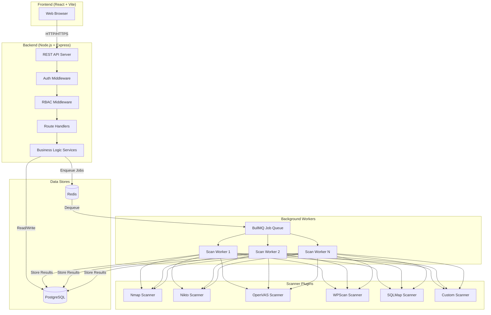
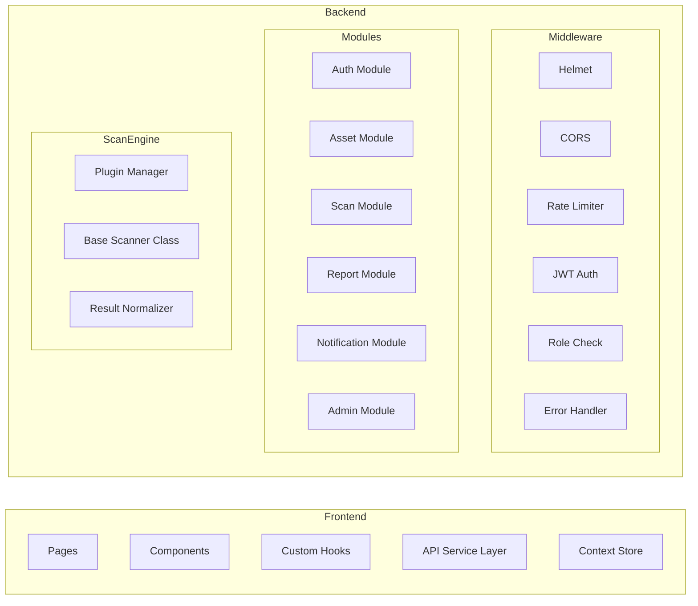
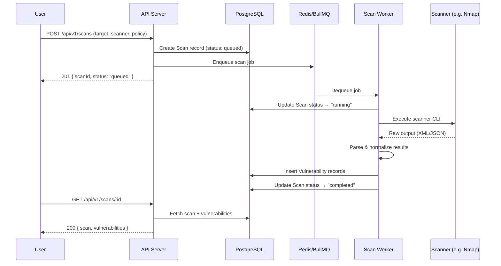
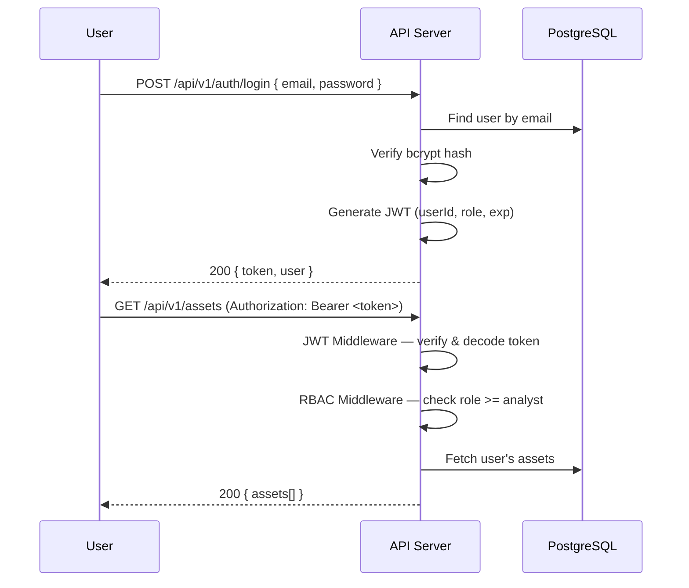
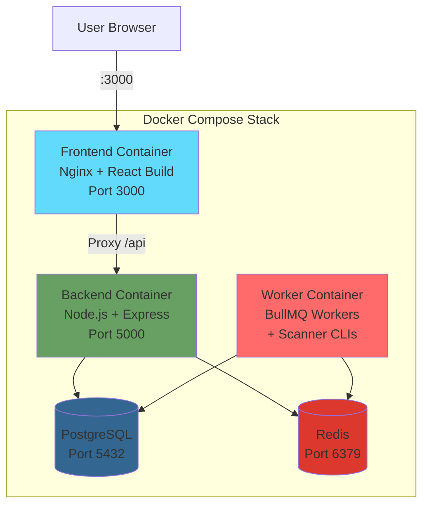

# System Architecture

## 1. High-Level Architecture

The system follows a **modular monolith** architecture with clear separation between frontend, backend API, background workers, and data stores.

## 2. Component Diagram

## 3. Data Flow — Scan Execution

## 4. Authentication & Authorization Flow

## 5. Deployment Topology

## 6. Security Architecture

### Layered Security Model
1. **Network Layer**: HTTPS enforcement, Helmet headers, CORS whitelist
2. **Application Layer**: JWT authentication, RBAC authorization, input validation (Joi)
3. **Data Layer**: Bcrypt password hashing, parameterized queries (Sequelize ORM), encrypted sensitive fields
4. **Infrastructure Layer**: Docker container isolation, non-root users, secret management via environment variables

### RBAC Role Matrix

| Resource | Admin | Analyst | Viewer |
|----------|-------|---------|--------|
| Manage Users | ✅ | ❌ | ❌ |
| Create/Edit Assets | ✅ | ✅ | ❌ |
| Launch Scans | ✅ | ✅ | ❌ |
| View Results | ✅ | ✅ | ✅ |
| Generate Reports | ✅ | ✅ | ✅ |
| System Settings | ✅ | ❌ | ❌ |

## 7. Logging & Monitoring

- **Application Logs**: Winston logger → console + file rotation
- **Request Logs**: Morgan HTTP request logging
- **Audit Trail**: Database table logging all user actions with timestamps
- **Error Tracking**: Centralized error handler with stack traces in dev, sanitized messages in production
- **Health Check**: `GET /api/v1/health` endpoint for uptime monitoring
