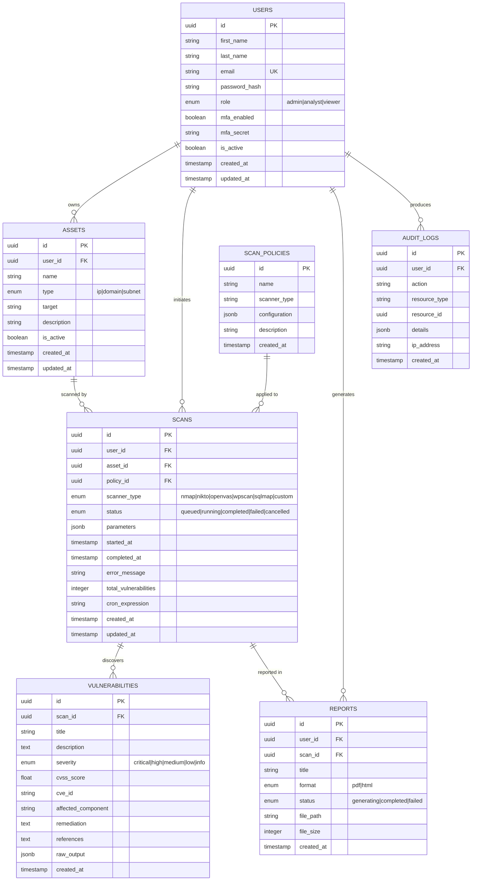

# Database Design

> **v3 status note:** schema reference (historic). Current implementation adds: engine columns on `vulnerabilities`/`public_vulnerabilities` (confidence, endpoint, parameter, detected_by, mitre_technique, mitre_tactic, evidence, cvss_vector), a `progress` column on `scans`, plus `scan_metadata` and `discovered_endpoints` tables written by the Python engine. `scanner_type` is effectively always `custom`.

## 1. Entity-Relationship Diagram



## 2. Table Schemas

### 2.1 Users Table
```sql
CREATE TABLE users (
    id UUID PRIMARY KEY DEFAULT gen_random_uuid(),
    first_name VARCHAR(100) NOT NULL,
    last_name VARCHAR(100) NOT NULL,
    email VARCHAR(255) UNIQUE NOT NULL,
    password_hash VARCHAR(255) NOT NULL,
    role VARCHAR(20) DEFAULT 'viewer' CHECK (role IN ('admin', 'analyst', 'viewer')),
    mfa_enabled BOOLEAN DEFAULT FALSE,
    mfa_secret VARCHAR(255),
    is_active BOOLEAN DEFAULT TRUE,
    created_at TIMESTAMP DEFAULT CURRENT_TIMESTAMP,
    updated_at TIMESTAMP DEFAULT CURRENT_TIMESTAMP
);

CREATE INDEX idx_users_email ON users(email);
CREATE INDEX idx_users_role ON users(role);
```

### 2.2 Assets Table
```sql
CREATE TABLE assets (
    id UUID PRIMARY KEY DEFAULT gen_random_uuid(),
    user_id UUID NOT NULL REFERENCES users(id) ON DELETE CASCADE,
    name VARCHAR(255) NOT NULL,
    type VARCHAR(20) NOT NULL CHECK (type IN ('ip', 'domain', 'subnet')),
    target VARCHAR(500) NOT NULL,
    description TEXT,
    is_active BOOLEAN DEFAULT TRUE,
    created_at TIMESTAMP DEFAULT CURRENT_TIMESTAMP,
    updated_at TIMESTAMP DEFAULT CURRENT_TIMESTAMP
);

CREATE INDEX idx_assets_user_id ON assets(user_id);
CREATE INDEX idx_assets_type ON assets(type);
```

### 2.3 Scan Policies Table
```sql
CREATE TABLE scan_policies (
    id UUID PRIMARY KEY DEFAULT gen_random_uuid(),
    name VARCHAR(255) NOT NULL,
    scanner_type VARCHAR(50) NOT NULL,
    configuration JSONB DEFAULT '{}',
    description TEXT,
    created_at TIMESTAMP DEFAULT CURRENT_TIMESTAMP
);
```

### 2.4 Scans Table
```sql
CREATE TABLE scans (
    id UUID PRIMARY KEY DEFAULT gen_random_uuid(),
    user_id UUID NOT NULL REFERENCES users(id) ON DELETE CASCADE,
    asset_id UUID NOT NULL REFERENCES assets(id) ON DELETE CASCADE,
    policy_id UUID REFERENCES scan_policies(id),
    scanner_type VARCHAR(50) NOT NULL,
    status VARCHAR(20) DEFAULT 'queued' CHECK (status IN ('queued','running','completed','failed','cancelled')),
    parameters JSONB DEFAULT '{}',
    started_at TIMESTAMP,
    completed_at TIMESTAMP,
    error_message TEXT,
    total_vulnerabilities INTEGER DEFAULT 0,
    cron_expression VARCHAR(100),
    created_at TIMESTAMP DEFAULT CURRENT_TIMESTAMP,
    updated_at TIMESTAMP DEFAULT CURRENT_TIMESTAMP
);

CREATE INDEX idx_scans_user_id ON scans(user_id);
CREATE INDEX idx_scans_asset_id ON scans(asset_id);
CREATE INDEX idx_scans_status ON scans(status);
CREATE INDEX idx_scans_scanner_type ON scans(scanner_type);
```

### 2.5 Vulnerabilities Table
```sql
CREATE TABLE vulnerabilities (
    id UUID PRIMARY KEY DEFAULT gen_random_uuid(),
    scan_id UUID NOT NULL REFERENCES scans(id) ON DELETE CASCADE,
    title VARCHAR(500) NOT NULL,
    description TEXT,
    severity VARCHAR(20) NOT NULL CHECK (severity IN ('critical','high','medium','low','info')),
    cvss_score DECIMAL(3,1) CHECK (cvss_score >= 0 AND cvss_score <= 10),
    cve_id VARCHAR(50),
    affected_component VARCHAR(500),
    remediation TEXT,
    references TEXT,
    raw_output JSONB,
    created_at TIMESTAMP DEFAULT CURRENT_TIMESTAMP
);

CREATE INDEX idx_vulns_scan_id ON vulnerabilities(scan_id);
CREATE INDEX idx_vulns_severity ON vulnerabilities(severity);
CREATE INDEX idx_vulns_cve_id ON vulnerabilities(cve_id);
```

### 2.6 Reports Table
```sql
CREATE TABLE reports (
    id UUID PRIMARY KEY DEFAULT gen_random_uuid(),
    user_id UUID NOT NULL REFERENCES users(id) ON DELETE CASCADE,
    scan_id UUID NOT NULL REFERENCES scans(id) ON DELETE CASCADE,
    title VARCHAR(255) NOT NULL,
    format VARCHAR(10) DEFAULT 'pdf' CHECK (format IN ('pdf', 'html')),
    status VARCHAR(20) DEFAULT 'generating' CHECK (status IN ('generating','completed','failed')),
    file_path VARCHAR(500),
    file_size INTEGER,
    created_at TIMESTAMP DEFAULT CURRENT_TIMESTAMP
);

CREATE INDEX idx_reports_user_id ON reports(user_id);
CREATE INDEX idx_reports_scan_id ON reports(scan_id);
```

### 2.7 Audit Logs Table
```sql
CREATE TABLE audit_logs (
    id UUID PRIMARY KEY DEFAULT gen_random_uuid(),
    user_id UUID REFERENCES users(id) ON DELETE SET NULL,
    action VARCHAR(100) NOT NULL,
    resource_type VARCHAR(50),
    resource_id UUID,
    details JSONB DEFAULT '{}',
    ip_address VARCHAR(45),
    created_at TIMESTAMP DEFAULT CURRENT_TIMESTAMP
);

CREATE INDEX idx_audit_user_id ON audit_logs(user_id);
CREATE INDEX idx_audit_action ON audit_logs(action);
CREATE INDEX idx_audit_created_at ON audit_logs(created_at);
```

## 3. Database Relationships Summary

| Parent | Child | Relationship | ON DELETE |
|--------|-------|-------------|-----------|
| users | assets | One-to-Many | CASCADE |
| users | scans | One-to-Many | CASCADE |
| users | reports | One-to-Many | CASCADE |
| users | audit_logs | One-to-Many | SET NULL |
| assets | scans | One-to-Many | CASCADE |
| scans | vulnerabilities | One-to-Many | CASCADE |
| scans | reports | One-to-Many | CASCADE |
| scan_policies | scans | One-to-Many | SET NULL |
