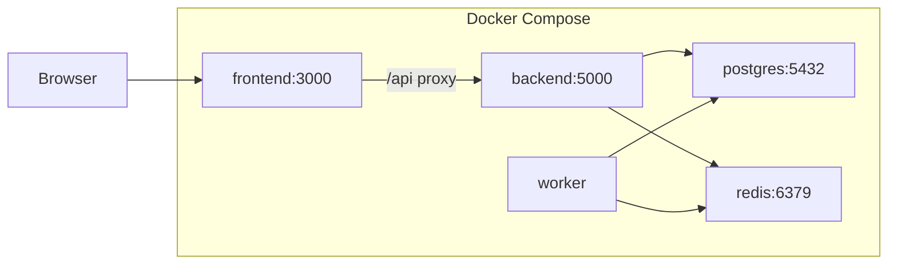
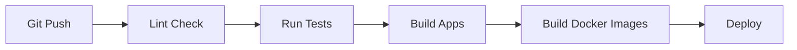

# DevOps & Deployment

## 1. Docker Compose Architecture



## 2. CI/CD Pipeline (GitHub Actions)



### Pipeline Stages:
1. **Lint**: ESLint on backend + frontend
2. **Test**: Jest unit tests + Supertest API tests
3. **Build**: Vite frontend build + Node.js check
4. **Docker**: Build and tag images
5. **Deploy**: Push to registry (optional)

## 3. Environment Configuration

### Development (.env)
```env
NODE_ENV=development
PORT=5000
DB_HOST=localhost
DB_PORT=5432
DB_NAME=vulnscan_dev
DB_USER=postgres
DB_PASSWORD=postgres
REDIS_HOST=localhost
REDIS_PORT=6379
JWT_SECRET=dev-secret-key-change-in-production
JWT_EXPIRES_IN=24h
CORS_ORIGIN=http://localhost:3000
SMTP_HOST=smtp.mailtrap.io
SMTP_PORT=587
SMTP_USER=
SMTP_PASS=
```

### Production considerations:
- Use strong random JWT_SECRET (256-bit)
- Enable HTTPS via reverse proxy (Nginx)
- Use managed PostgreSQL and Redis
- Set NODE_ENV=production
- Enable log rotation
- Use Docker secrets for sensitive values

## 4. Deployment Steps

### Local Development
```bash
# 1. Clone repository
git clone <repo-url>
cd FINAL-YEAR-PROJECT

# 2. Install dependencies
cd backend && npm install
cd ../frontend && npm install

# 3. Start PostgreSQL and Redis (Docker)
docker run -d --name postgres -p 5432:5432 -e POSTGRES_DB=vulnscan_dev -e POSTGRES_PASSWORD=postgres postgres:15
docker run -d --name redis -p 6379:6379 redis:7

# 4. Run database migrations
cd backend && npm run db:sync

# 5. Start backend
npm run dev

# 6. Start frontend (new terminal)
cd frontend && npm run dev
```

### Docker Compose Deployment
```bash
# Single command to start everything
docker-compose up --build -d

# View logs
docker-compose logs -f

# Stop all services
docker-compose down

# Reset database
docker-compose down -v  # removes volumes
docker-compose up --build -d
```

## 5. Monitoring & Health Checks

- **Health endpoint**: `GET /api/v1/health` returns DB + Redis status
- **Docker health checks**: Configured in docker-compose.yml
- **Log aggregation**: Winston logs written to `./logs/` with daily rotation
- **Resource monitoring**: Docker stats for container metrics
