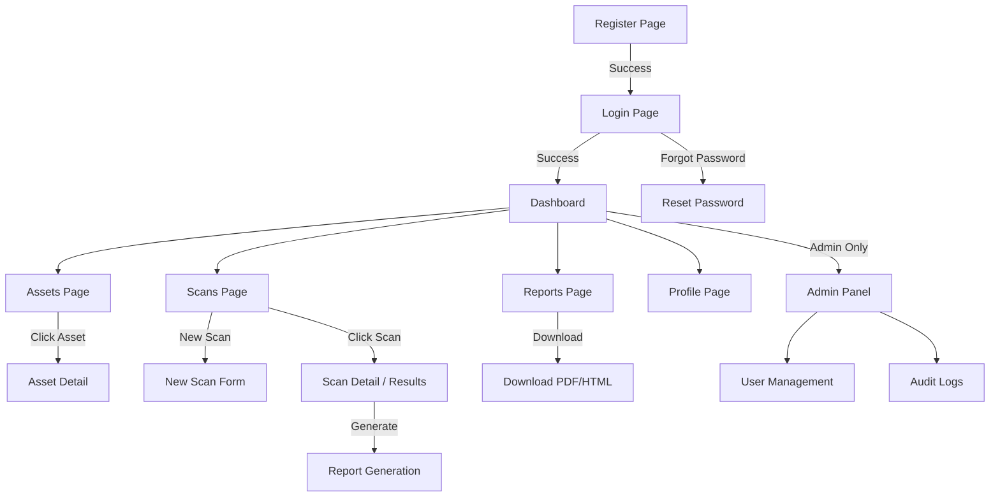

# Frontend Design

## 1. Technology Stack
- **React 18** with functional components and hooks
- **Vite** for fast builds and HMR
- **Tailwind CSS** for utility-first styling
- **React Router v6** for client-side routing
- **Chart.js** (via react-chartjs-2) for dashboards
- **Axios** for API calls
- **React Context** for global state (auth)

## 2. Page Flow Diagram



## 3. Component Hierarchy

```
App
├── AuthProvider (Context)
├── Router
│   ├── PublicRoutes
│   │   ├── LoginPage
│   │   └── RegisterPage
│   └── ProtectedRoutes (requires auth)
│       ├── Layout
│       │   ├── Sidebar
│       │   ├── Navbar
│       │   └── MainContent
│       │       ├── DashboardPage
│       │       │   ├── StatsCards (4x)
│       │       │   ├── SeverityChart (Doughnut)
│       │       │   ├── ScanTrendChart (Line)
│       │       │   └── RecentScansTable
│       │       ├── AssetsPage
│       │       │   ├── AssetFilters
│       │       │   ├── DataTable
│       │       │   └── AssetModal (create/edit)
│       │       ├── ScansPage
│       │       │   ├── ScanFilters
│       │       │   ├── DataTable
│       │       │   └── NewScanModal
│       │       ├── ScanDetailPage
│       │       │   ├── ScanInfoCard
│       │       │   ├── SeveritySummary
│       │       │   └── VulnerabilitiesTable
│       │       ├── ReportsPage
│       │       │   └── ReportsTable
│       │       ├── ProfilePage
│       │       └── AdminPage (role: admin)
│       │           ├── UsersTable
│       │           └── AuditLogsTable
│       └── NotFoundPage
```

## 4. Page Descriptions

### 4.1 Login Page
- Clean centered card design with gradient background
- Email + password fields with validation
- "Remember me" checkbox
- Link to Register page
- Error messages displayed inline

### 4.2 Register Page  
- Card form: first name, last name, email, password, confirm password
- Real-time password strength indicator
- Link back to Login

### 4.3 Dashboard
- **Top row**: 4 stats cards (Total Assets, Total Scans, Vulnerabilities Found, Critical Issues) with icons and color coding
- **Middle row**: 
  - Left: Doughnut chart — severity distribution (Critical=red, High=orange, Medium=yellow, Low=blue, Info=gray)
  - Right: Line chart — scans per day over last 30 days
- **Bottom**: Recent scans table (last 10) with status badges

### 4.4 Assets Page
- Header with "Add Asset" button
- Filter bar: search input + type dropdown (IP/Domain/Subnet)
- Data table: Name, Type, Target, Status, Created, Actions (edit/delete)
- Modal for create/edit with form validation
- Confirmation dialog for delete

### 4.5 Scans Page
- Header with "New Scan" button
- Filter bar: status dropdown, scanner type dropdown, date range
- Data table: Target, Scanner, Status, Vulnerabilities, Started, Duration, Actions
- Status badges: Queued (gray), Running (blue pulse), Completed (green), Failed (red)
- "New Scan" modal: select asset, scanner type, configure parameters

### 4.6 Scan Detail Page
- Scan info card: Target, Scanner, Status, Start/End time, Duration
- Severity summary bar: colored segments showing distribution
- Vulnerabilities table: Title, Severity (badge), CVSS, CVE ID, Affected Component
- Click vulnerability row to expand details (description, remediation, references)
- "Generate Report" button

### 4.7 Reports Page
- Table: Title, Scan, Format, Status, Size, Created, Actions (download)
- Download button triggers file download

### 4.8 Profile Page
- User info display/edit form
- Change password section
- MFA toggle (future)

### 4.9 Admin Panel
- Tab navigation: Users | Audit Logs
- Users tab: table with Name, Email, Role, Status, Actions (change role, activate/deactivate)
- Audit Logs tab: table with User, Action, Resource, IP, Timestamp + filters

## 5. Reusable Components

| Component | Description |
|-----------|-------------|
| `Sidebar` | Fixed left sidebar with navigation links, user info, logo |
| `Navbar` | Top bar with page title, notifications icon, user avatar dropdown |
| `StatsCard` | Metric card with icon, value, label, color accent |
| `DataTable` | Sortable, paginated table with configurable columns |
| `Modal` | Overlay dialog for forms and confirmations |
| `SeverityBadge` | Colored pill: critical=red, high=orange, medium=yellow, low=blue, info=gray |
| `StatusBadge` | Scan status pill with appropriate colors |
| `LoadingSpinner` | Centered spinner for loading states |
| `EmptyState` | Illustration + message for empty data |
| `ConfirmDialog` | "Are you sure?" modal with cancel/confirm buttons |

## 6. Design System

### Color Palette
```
Primary:        #6366f1 (Indigo-500)
Primary Dark:   #4f46e5 (Indigo-600)
Background:     #0f172a (Slate-900)
Surface:        #1e293b (Slate-800)
Surface Light:  #334155 (Slate-700)
Text Primary:   #f8fafc (Slate-50)
Text Secondary: #94a3b8 (Slate-400)
Critical:       #ef4444 (Red-500)
High:           #f97316 (Orange-500)
Medium:         #eab308 (Yellow-500)
Low:            #3b82f6 (Blue-500)
Info:           #6b7280 (Gray-500)
Success:        #22c55e (Green-500)
```

### Typography
- **Font**: Inter (Google Fonts)
- **Headings**: 600 weight (semi-bold)
- **Body**: 400 weight (regular)

### Spacing & Layout
- Sidebar: 256px fixed width
- Content area: fluid with max-width 1280px
- Card padding: 24px
- Grid gap: 24px
- Border radius: 8px (cards), 6px (buttons), 4px (inputs)
