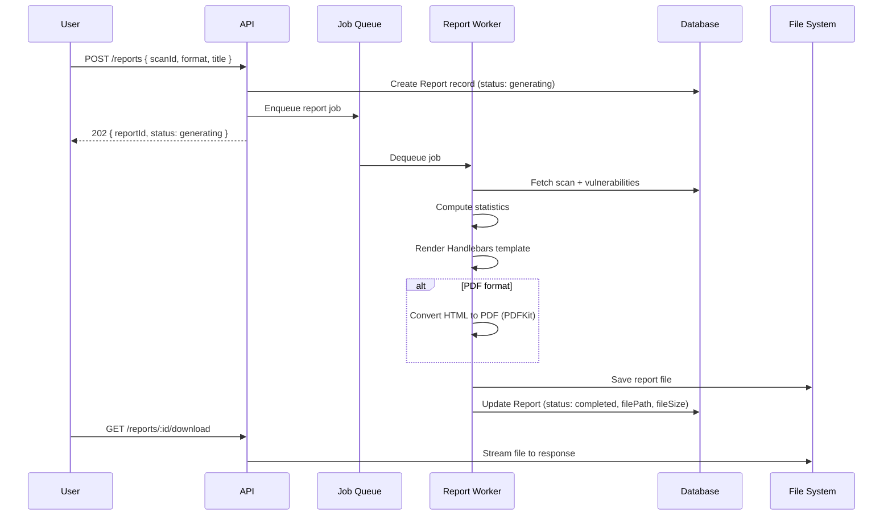

# Reporting System Design

## 1. Report Generation Flow



## 2. Report Sections

### Executive Summary
- Scan target information
- Scan date and duration
- Total vulnerabilities by severity
- Overall risk score (weighted)

### Severity Distribution Chart
- Doughnut/pie chart embedded in report
- Color-coded by severity level

### Vulnerability Findings Table
| # | Title | Severity | CVSS | CVE | Component |
|---|-------|----------|------|-----|-----------|
| 1 | Open SSH Port | Info | 0.0 | — | 22/tcp |
| 2 | Outdated Apache | High | 7.5 | CVE-2021-44790 | 80/tcp |

### Detailed Findings
For each vulnerability:
- **Title** and severity badge
- **Description**: What was found
- **Affected Component**: Port, service, URL
- **CVSS Score**: Numeric risk rating
- **CVE Reference**: Link to NVD
- **Remediation**: How to fix
- **References**: External links

### Report Footer
- Report generation timestamp
- Scanner version
- Disclaimer text

## 3. Template System

Reports use **Handlebars** templates that can be customized:

```
backend/src/reports/
├── templates/
│   ├── report.hbs          # Main HTML template
│   └── styles.css          # Report styling
├── ReportGenerator.js      # Generation logic
└── charts.js               # Chart data preparation
```

## 4. Risk Score Calculation

```javascript
function calculateRiskScore(vulnerabilities) {
  const weights = { critical: 10, high: 7, medium: 4, low: 1, info: 0 };
  let totalWeight = 0;
  let maxPossible = vulnerabilities.length * 10;
  
  vulnerabilities.forEach(v => {
    totalWeight += weights[v.severity] || 0;
  });
  
  return maxPossible > 0 
    ? Math.round((totalWeight / maxPossible) * 100) 
    : 0;
}
```

## 5. Export Formats

| Format | Method | Content-Type |
|--------|--------|-------------|
| PDF | PDFKit with HTML-to-PDF rendering | application/pdf |
| HTML | Handlebars template rendered to file | text/html |
| CSV | Vulnerability data as comma-separated | text/csv |
