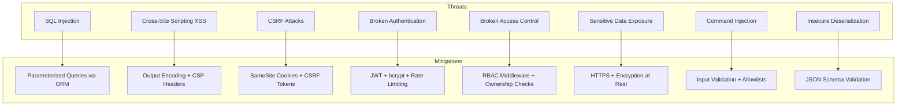

# Security Design

> **v3 status note:** matches the current implementation except that scanner commands are not shell-based — scanning is a Python subprocess (`spawn` with argument array, `shell:false`) with SSRF guards in both Node.js and Python.

## 1. Threat Model



## 2. OWASP Top 10 Protections

| # | Vulnerability | Protection Implemented |
|---|--------------|----------------------|
| A01 | Broken Access Control | RBAC middleware, resource ownership validation |
| A02 | Cryptographic Failures | bcrypt hashing, HTTPS, secure JWT secrets |
| A03 | Injection | Sequelize ORM (parameterized), Joi input validation |
| A04 | Insecure Design | Security architecture review, threat modeling |
| A05 | Security Misconfiguration | Helmet headers, CORS whitelist, env-based config |
| A06 | Vulnerable Components | npm audit, dependabot, pinned versions |
| A07 | Auth Failures | JWT expiry, rate limiting, account lockout |
| A08 | Data Integrity Failures | Input validation, CSRF protection, signed tokens |
| A09 | Logging Failures | Winston structured logging, audit trail table |
| A10 | SSRF | Target validation, allowlist-based scanning |

## 3. Authentication Security

### Password Policy
- Minimum 8 characters
- At least 1 uppercase, 1 lowercase, 1 digit, 1 special character
- bcrypt cost factor: 12
- No password in API responses

### JWT Configuration
```javascript
{
  secret: process.env.JWT_SECRET,  // 256-bit random key
  expiresIn: '24h',
  algorithm: 'HS256',
  issuer: 'vulnscan-pro'
}
```

### Rate Limiting
```javascript
{
  windowMs: 15 * 60 * 1000,  // 15 minutes
  max: 100,                   // 100 requests per window (general)
  authMax: 5,                 // 5 login attempts per window
  message: 'Too many requests'
}
```
Email-sending endpoints (`/auth/resend-verification`, `/auth/forgot-password`) are limited to 5 requests/hour per IP to prevent email bombing.

### Email Verification
- Accounts are created **unverified**; login is blocked until the email is confirmed via a tokenized link (24h expiry).
- `POST /auth/verify-email` marks the account verified; `POST /auth/resend-verification` issues a fresh token.
- Seed users and pre-existing database users are backfilled as verified so they are never locked out.

### Password Reset
- `POST /auth/forgot-password` emails a tokenized reset link (1h expiry) and always returns the same response to prevent user enumeration.
- `POST /auth/reset-password` validates the token, enforces the password policy, and clears the token after use.

### Multi-Factor Authentication (TOTP)
- `POST /auth/mfa/setup` generates a Base32 secret + `otpauth://` provisioning URI (stored in `mfa_secret`).
- `POST /auth/mfa/enable` verifies the first 6-digit code before activating MFA; `POST /auth/mfa/disable` requires the current code.
- Logins on MFA-enabled accounts return a short-lived `mfaToken`; `POST /auth/mfa/verify` exchanges it (plus TOTP code) for a full JWT. Codes are verified with a ±1 time-step window (30s) to tolerate clock drift.

## 4. Input Validation (Joi Schemas)

```javascript
// Example: Asset creation validation
const assetSchema = Joi.object({
  name: Joi.string().min(1).max(255).required(),
  type: Joi.string().valid('ip', 'domain', 'subnet').required(),
  target: Joi.string().max(500).required()
    .when('type', {
      is: 'ip',
      then: Joi.string().ip()
    })
    .when('type', {
      is: 'domain',
      then: Joi.string().domain()
    }),
  description: Joi.string().max(1000).allow('')
});
```

## 5. HTTP Security Headers (Helmet)

```javascript
app.use(helmet({
  contentSecurityPolicy: {
    directives: {
      defaultSrc: ["'self'"],
      scriptSrc: ["'self'"],
      styleSrc: ["'self'", "'unsafe-inline'"],
      imgSrc: ["'self'", "data:"],
      connectSrc: ["'self'"],
      fontSrc: ["'self'", "https://fonts.gstatic.com"],
      objectSrc: ["'none'"],
      frameSrc: ["'none'"]
    }
  },
  hsts: { maxAge: 31536000, includeSubDomains: true },
  noSniff: true,
  referrerPolicy: { policy: 'strict-origin-when-cross-origin' }
}));
```

## 6. Command Injection Prevention

Scanner target inputs are validated against strict patterns before being passed to shell commands:

```javascript
const VALIDATORS = {
  ip: /^(\d{1,3}\.){3}\d{1,3}$/,
  domain: /^[a-zA-Z0-9][a-zA-Z0-9-_.]+\.[a-zA-Z]{2,}$/,
  subnet: /^(\d{1,3}\.){3}\d{1,3}\/\d{1,2}$/
};

// All scanner commands use spawn() (not exec()) with argument arrays
// This prevents shell injection as arguments are not interpreted by a shell
```

## 7. Audit Logging

Every significant user action is logged:

```javascript
// Logged events
const AUDIT_EVENTS = [
  'user.login', 'user.logout', 'user.register',
  'user.password_change', 'user.role_change',
  'asset.create', 'asset.update', 'asset.delete',
  'scan.create', 'scan.cancel', 'scan.retry',
  'report.generate', 'report.download',
  'admin.user_update', 'admin.user_deactivate'
];

// Log entry format
{
  userId: 'uuid',
  action: 'scan.create',
  resourceType: 'scan',
  resourceId: 'uuid',
  details: { scannerType: 'nmap', target: '192.168.1.1' },
  ipAddress: '10.0.0.5',
  createdAt: '2026-01-15T10:30:00Z'
}
```

## 8. Secure Coding Practices Checklist

- [x] All database queries use ORM (no raw SQL with user input)
- [x] All user inputs validated with Joi before processing
- [x] Passwords hashed with bcrypt (cost 12)
- [x] JWT tokens with expiry, signed with strong secret
- [x] RBAC on every protected endpoint
- [x] Resource ownership validated (users can't access others' data)
- [x] Rate limiting on auth endpoints
- [x] Helmet security headers enabled
- [x] CORS restricted to frontend origin
- [x] Error messages don't expose internal details in production
- [x] Scanner commands use spawn() with argument arrays (no shell)
- [x] File uploads validated and sandboxed (reports directory)
- [x] Dependencies audited with npm audit
- [x] Environment variables for all secrets (never hardcoded)
- [x] Structured logging with no sensitive data in logs
