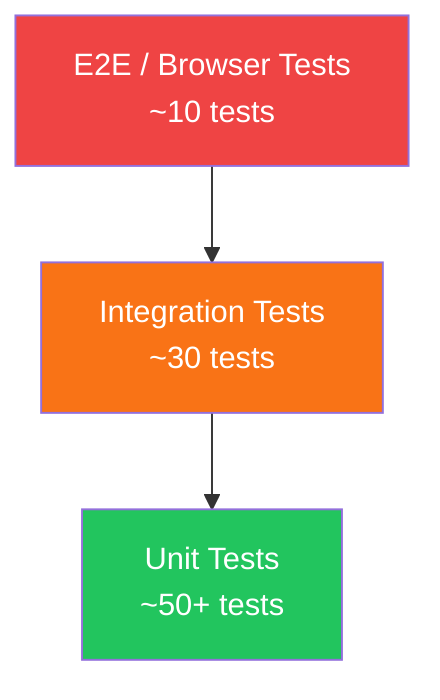

# Testing Strategy

> **v3 status note:** historical strategy. Current suites: backend Jest (23 tests), Python engine pytest (37 tests); no Nmap/Nikto parser tests exist (those scanners were removed). See `docs/technical-assessment.md`.

## 1. Testing Pyramid



## 2. Unit Tests (Jest)

### Auth Module
| Test Case | Input | Expected |
|-----------|-------|----------|
| Register valid user | Valid credentials | 201, user created |
| Register duplicate email | Existing email | 409, conflict error |
| Register invalid email | "notanemail" | 400, validation error |
| Login valid credentials | Correct email/pass | 200, JWT token returned |
| Login wrong password | Wrong password | 401, unauthorized |
| Login non-existent user | Unknown email | 401, unauthorized |

### Asset Module
| Test Case | Input | Expected |
|-----------|-------|----------|
| Create IP asset | Valid IP target | 201, asset created |
| Create domain asset | Valid domain | 201, asset created |
| Create invalid IP | "999.999.999.999" | 400, validation error |
| List user's assets | Auth token | 200, array of assets |
| Update asset | Valid update data | 200, updated asset |
| Delete asset | Valid asset ID | 204, no content |
| Access other user's asset | Wrong user's ID | 404, not found |

### Scan Module
| Test Case | Input | Expected |
|-----------|-------|----------|
| Create scan | Valid asset + scanner | 201, scan queued |
| Create scan invalid scanner | Unknown scanner type | 400, validation error |
| Get scan status | Valid scan ID | 200, scan with status |
| Cancel running scan | Running scan ID | 200, status: cancelled |
| List scans with filters | Status filter | 200, filtered results |

### Scanner Parsers
| Test Case | Input | Expected |
|-----------|-------|----------|
| Parse Nmap XML | Sample XML output | Normalized vulnerability array |
| Parse Nikto JSON | Sample JSON output | Normalized vulnerability array |
| Parse empty output | Empty string | Empty array |
| Handle malformed XML | Invalid XML | Parse error handled |

### Report Module
| Test Case | Input | Expected |
|-----------|-------|----------|
| Generate PDF report | Valid scan ID | File created, status: completed |
| Generate HTML report | Valid scan ID | HTML file created |
| Risk score calculation | Vulnerability array | Numeric score 0-100 |

## 3. Integration Tests (Supertest)

### API Integration Tests
```javascript
// Example test structure
describe('POST /api/v1/auth/register', () => {
  it('should register a new user', async () => {
    const res = await request(app)
      .post('/api/v1/auth/register')
      .send({ firstName: 'Test', lastName: 'User', email: 'test@example.com', password: 'Test@123' });
    expect(res.status).toBe(201);
    expect(res.body.success).toBe(true);
    expect(res.body.data).toHaveProperty('id');
  });

  it('should reject duplicate email', async () => {
    const res = await request(app)
      .post('/api/v1/auth/register')
      .send({ firstName: 'Test', lastName: 'User', email: 'test@example.com', password: 'Test@123' });
    expect(res.status).toBe(409);
  });
});
```

### Test Database
- Uses separate PostgreSQL database: `vulnscan_test`
- Database reset before each test suite
- Seed data for test fixtures

## 4. Frontend Tests (Vitest + React Testing Library)

| Component | Test |
|-----------|------|
| LoginPage | Renders form, validates inputs, calls API |
| DataTable | Renders rows, handles pagination |
| SeverityBadge | Renders correct color per severity |
| StatsCard | Displays value and label |
| Modal | Opens/closes, renders children |

## 5. Test Commands

```bash
# Backend tests
cd backend
npm test                    # Run all tests
npm run test:coverage       # With coverage report
npm run test:watch          # Watch mode

# Frontend tests
cd frontend
npm test                    # Run all tests
npm run test:coverage       # With coverage report
```

## 6. Coverage Targets

| Module | Target |
|--------|--------|
| Backend Controllers | ≥ 80% |
| Backend Services | ≥ 85% |
| Scanner Parsers | ≥ 90% |
| Frontend Components | ≥ 70% |
| Overall | ≥ 75% |
